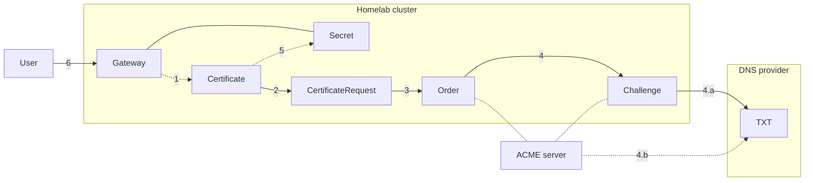

# Certificate management

Certificates are generated and managed by [cert-manager](https://cert-manager.io) with [Let's Encrypt](https://letsencrypt.org),
and renewed automatically.

cert-manager watches `Gateway` resources across the cluster.
When you create a `Gateway` with the issuer annotation:

```yaml
apiVersion: gateway.networking.k8s.io/v1
kind: Gateway
metadata:
  annotations:
    cert-manager.io/cluster-issuer: letsencrypt-prod
  name: gateway
  namespace: istio-system
spec:
  gatewayClassName: istio
  listeners:
    - name: https
      hostname: '*.example.com'
      port: 443
      protocol: HTTPS
      tls:
        mode: Terminate
        certificateRefs:
          - name: wildcard-tls
      allowedRoutes:
        namespaces:
          from: All
```



1. cert-manager creates a corresponding `Certificate` resource
2. Based on the `Certificate` resource, cert-manager creates a `CertificateRequest` resource to request a signed certificate from the configured `ClusterIssuer`
3. The `CertificateRequest` will create an order with an ACME server (we use Let's Encrypt), which is represented by the `Order` resource
4. Then cert-manager will perform a [DNS-01](https://cert-manager.io/docs/configuration/acme/dns01) `Challenge`:
    1. Create a DNS TXT record (contains a computed key)
    2. The ACME server retrieve this key via a DNS lookup and validate that we own the domain for the requested certificate
5. cert-manager stores the certificate (typically `tls.crt` and `tls.key`) in the `Secret` specified in the `Gateway` configuration
6. Now you can access the HTTPS website with a valid certificate

A much more detailed diagram can be found in the official documentation under [certificate lifecycle](https://cert-manager.io/docs/concepts/certificate/#certificate-lifecycle).
