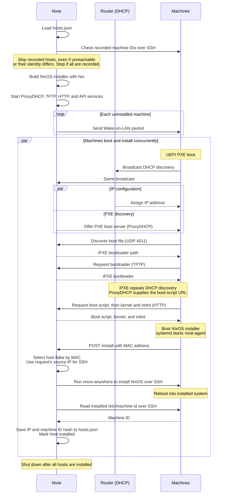

# PXE boot

Here's how it looks like in action (this is an old clip so the logs look different now):

<iframe width="560" height="315" src="https://www.youtube-nocookie.com/embed/y-d7btNNAT8" title="YouTube video player" frameborder="0" allow="accelerometer; autoplay; clipboard-write; encrypted-media; gyroscope; picture-in-picture" allowfullscreen></iframe>
