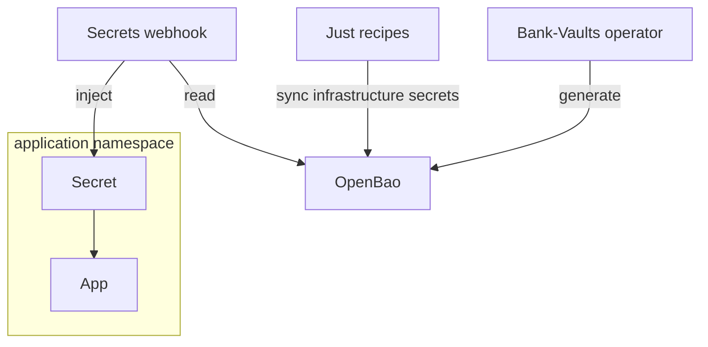

# Secrets management

## Overview

- Secrets are stored in [OpenBao](https://openbao.org/docs/).
- Integrate with GitOps using the [Bank-Vaults secrets webhook](https://bank-vaults.dev/docs/mutating-webhook/).
- Secrets that can be generated are automatically generated and stored in OpenBao.



## Generated and external secrets

- Bank-Vaults generates secrets configured in `infra/src/modules/platform/openbao.tf`, keeping existing values.
- `just deploy` syncs infrastructure credentials from OpenTofu's `secrets` outputs, along with SSO and Forgejo credentials.

## Infra secret outputs

To publish secrets from an OpenTofu module, add a sensitive `secrets` output.

```hcl
output "secrets" {
  sensitive = true
  value = {
    "cert-manager/cloudflare" = { # OpenBao path
      api_token = cloudflare_account_token.cert_manager.value # secret values
    }
  }
}
```

`just deploy production` writes these under OpenBao's `secret` KV mount.

## SSO access

OpenBao uses Kanidm groups to restrict its OIDC roles:

| Role | Required group | Access to the `secret` mount |
| --- | --- | --- |
| `admins` | `admins` | Read, create, update, patch, list, and delete secrets |
| `developers` | `developers` | Create, update, and patch secrets |

Both roles cover all application paths, including service credentials.
Developers cannot read values or metadata, list names, or delete secrets.
Neither role can manage access policies, authentication methods, or secret engines.
Application service accounts keep their namespace-scoped read access.

In the OpenBao GUI, select **OIDC** and enter the role in the **Role** field.
The default role is `admins`. Developers must enter `developers`.
A user in both groups can select either role.
Sign in again after a role change to receive its new policy.

## Secret injection

Secrets use `<namespace>/<name>` paths, for example `forgejo/admin`.
Applications can only read secrets for their own namespace.

When you apply a labeled Secret, for example:

```yaml
apiVersion: v1
kind: Secret
metadata:
  name: forgejo-admin
  namespace: forgejo
  labels:
    homelab.khuedoan.com/bao-secret: "true"
stringData:
  username: forgejo_admin
  password: bao:secret/data/forgejo/admin#password
```

The webhook reads the password from OpenBao and stores it in the Kubernetes Secret.
The OpenBao record must already exist. Argo CD ignores the injected values.

References are resolved when the Secret is created or updated.
After rotation, reapply the references and restart the applications using the Secret.

Please see the [official documentation](https://bank-vaults.dev/docs/mutating-webhook/) for more information.
