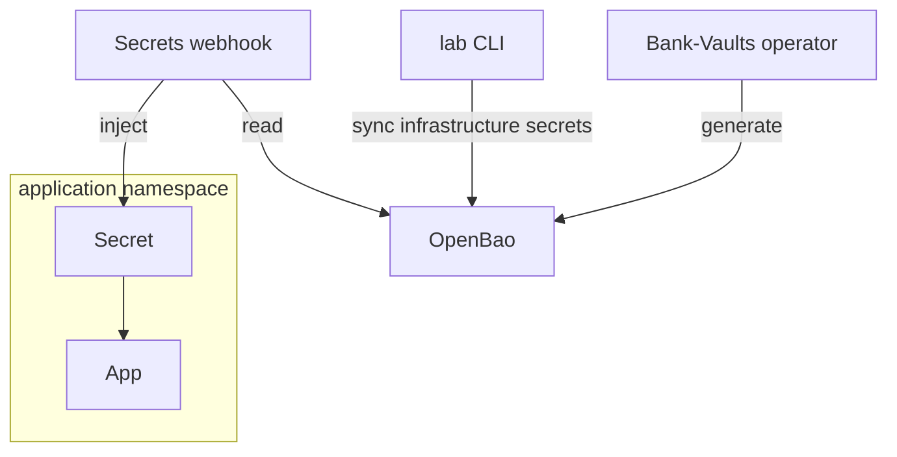

# Secrets management

## Overview

- Secrets are stored in [OpenBao](https://openbao.org/docs/).
- Integrate with GitOps using the [Bank-Vaults secrets webhook](https://bank-vaults.dev/docs/mutating-webhook/).
- Secrets that can be generated are automatically generated and stored in OpenBao.



## Generated and external secrets

- Bank-Vaults generates secrets configured in `infra/_modules/platform/openbao.tf`, keeping existing values.
- The lab CLI syncs infrastructure credentials from OpenTofu's `secrets` outputs, along with SSO and Forgejo credentials.

## Secret injection

Secrets use `<namespace>/<name>` paths, for example `forgejo/admin`.
Applications can only read secrets for their own namespace.

When you apply a labeled Secret, for example:

```yaml
apiVersion: v1
kind: Secret
metadata:
  name: forgejo-admin
  namespace: forgejo
  labels:
    homelab.khuedoan.com/bao-secret: "true"
stringData:
  username: forgejo_admin
  password: bao:secret/data/forgejo/admin#password
```

The webhook reads the password from OpenBao and stores it in the Kubernetes Secret.
The OpenBao record must already exist. Argo CD ignores the injected values.

References are resolved when the Secret is created or updated.
After rotation, reapply the references and restart the applications using the Secret.

Please see the [official documentation](https://bank-vaults.dev/docs/mutating-webhook/) for more information.
