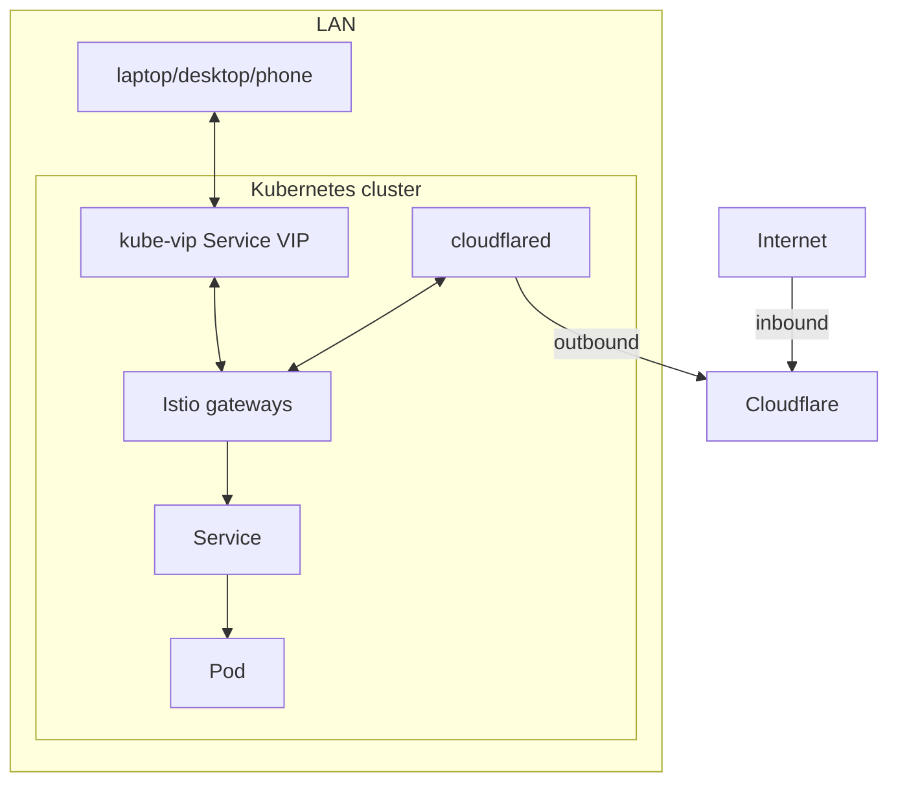

# Networking

- Flannel provides pod networking.
- kube-vip provides the control-plane VIP and Service load balancing.
- Tailscale and WireGuard provide remote access when you're not at home.
- Istio gateways route HTTP traffic to applications.
- Cloudflare Tunnel exposes services to the internet through an outbound connection.
- Istio ambient mesh encrypts traffic between application Pods without sidecars, with traffic visualization using Kiali.
