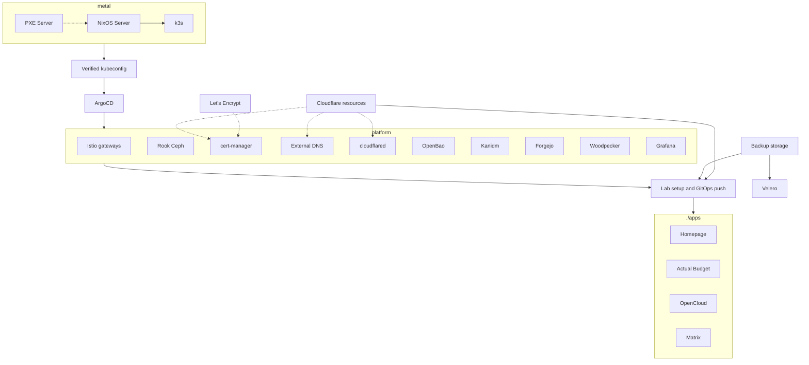

# Overview

## Components

Main components:

- `./infra`: bare metal management, Kubernetes, and platform services
- `./apps`: user facing applications

Support components:

- `./docs`: all documentation go here, this will generate a searchable web UI
- `./cli`: automate common operations (cluster enrollment, secrets, SSO, Forgejo setup...)
- `./tests`: automated tests for the entire system

## Provisioning flow

After editing the configuration files, run a single make command to:

- (1) Build the `metal` and `cluster` units:
    - Create an ephemeral, stateless PXE server
    - Install NixOS on all servers in parallel
    - Build a Kubernetes cluster (based on k3s)
    - Export and verify its kubeconfig
- (2) Bootstrap GitOps with ArgoCD
- (3) Deploy platform components
- (4) Push the GitOps repo to Forgejo
- (5) Deploy applications in `./apps` with ArgoCD

